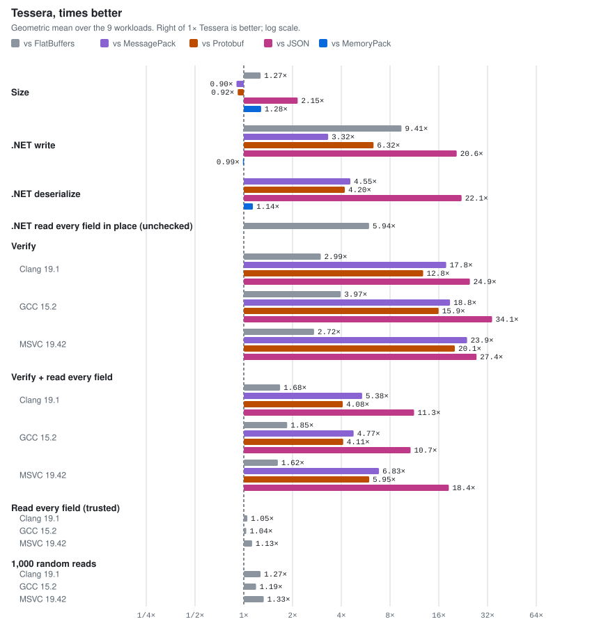
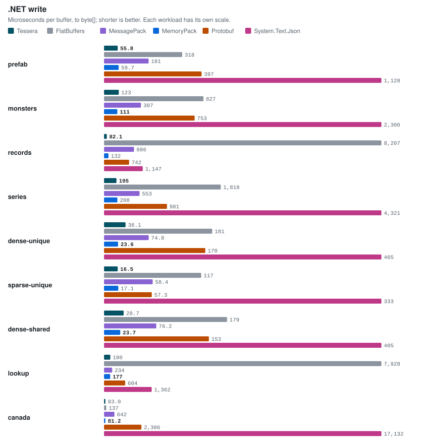
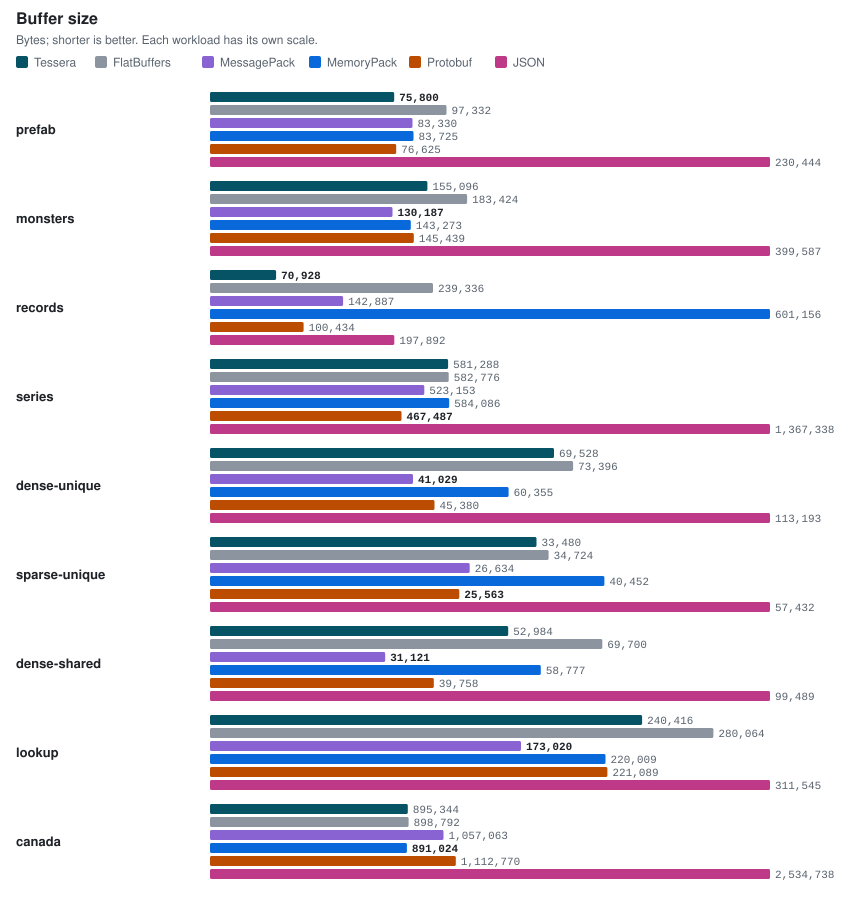
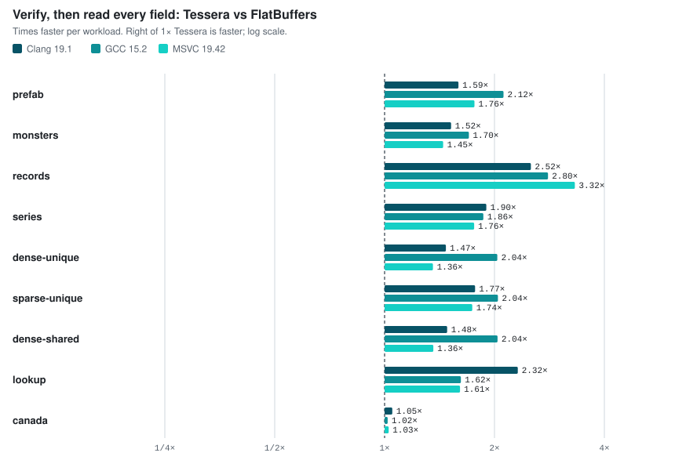
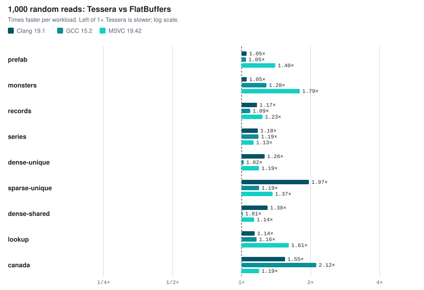
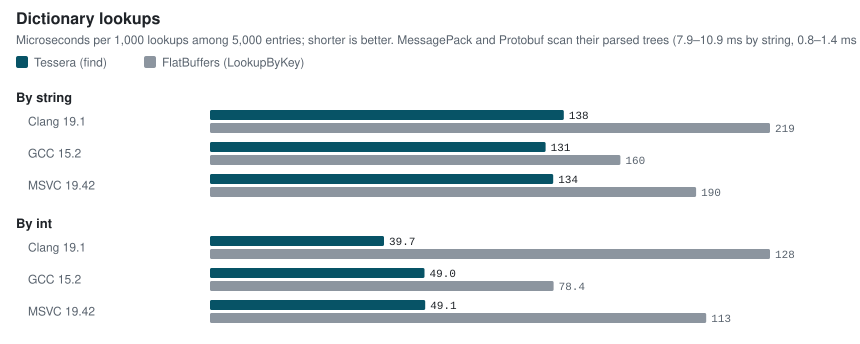

<p align="center">
  <picture>
    <source media="(prefers-color-scheme: dark)" srcset="docs/images/tessera-icon-dark.svg">
    
  </picture>
</p>

<h1 align="center">Tessera</h1>

<p align="center">
  Binary buffers from plain .NET objects, read in place by C++20.<br>
  No IDL, no parsing, and no allocations on the read side.
</p>

<p align="center">
  <a href="docs/README.md">Documentation</a> ·
  <a href="docs/guide/installation.md">Installation</a> ·
  <a href="docs/attributes/README.md">Attributes</a> ·
  <a href="docs/diagnostics/README.md">Diagnostics</a> ·
  <a href="docs/BENCHMARKS.md">Benchmarks</a>
</p>

## 1. Example

Your C# classes are the schema:

```csharp
namespace Game;

public class Monster
{
    public string? Name;
    public short Hp = 100;            // equal to its default: not stored
    public int? Mana;                 // nullable: C++ can tell whether it was set
    public Vec3 Position;             // plain struct: stored inline
    public List<Weapon>? Weapons;
}

public class Weapon { public string? Name; public int Damage; }

public record struct Vec3(float X, float Y, float Z);
```

Serialize one. That call is all the source generator needs: it writes a serializer for `Monster` and for every type
`Monster` uses.

```csharp
using Game;
using Tessera;

var orc = new Monster
{
    Name = "Orc",
    Mana = 25,
    Position = new Vec3(1, 2, 3),
    Weapons = [new() { Name = "Axe", Damage = 9 }, new() { Name = "Bow", Damage = 4 }],
};

byte[] buffer = TesseraSerializer.Serialize(orc);
File.WriteAllBytes("monster.bin", buffer);
Console.WriteLine($"{buffer.Length} bytes");
```

```text
328 bytes
```

The same build writes a C++ header for each class. From `game/Monster.tessera.hpp` (shortened):

```cpp
class Monster final : public tessera::Table<Monster> {
public:
    std::string_view            name() const noexcept;      // string? Name
    std::int16_t                hp() const noexcept;        // short Hp = 100
    std::optional<std::int32_t> mana() const noexcept;      // int? Mana
    const Vec3&                 position() const noexcept;  // Vec3 Position
    tessera::Vector<Weapon>     weapons() const noexcept;   // List<Weapon>? Weapons
    // has_name(), has_hp() ...: whether each member was stored
};
```

C++ verifies the buffer once, then reads it where it lies:

```cpp
#include "game/Monster.tessera.hpp"

// data, size: the 328 bytes of monster.bin, in 8-byte aligned memory
tessera::Reader<game::Monster> reader(data, size);  // verifies the buffer once
if (!reader) return 1;

game::Monster orc = reader.root();  // a view: reads in place, nothing is parsed or copied
const game::Vec3& p = orc.position();
std::cout << orc.name() << ": hp " << orc.hp() << ", mana " << orc.mana().value_or(0)
          << ", position " << p.x << ' ' << p.y << ' ' << p.z << '\n';
for (game::Weapon w : orc.weapons()) std::cout << "  " << w.name() << ": damage " << w.damage() << '\n';
```

```text
Orc: hp 100, mana 25, position 1 2 3
  Axe: damage 9
  Bow: damage 4
```

`hp` wasn't saved, because it equaled its default value, so C++ returned the default compiled into the header. `orc`
is a pointer into the buffer, wrapped in a class: keep the buffer (and the `Reader`) alive while you use it. The whole
example, including loading the file, is in [samples/Quickstart](samples/Quickstart).

### What the 328 bytes hold

| Part | Bytes | Contents |
|---|---:|---|
| Header | 16 | where the top-level object starts, a format marker and version, and a hash of the classes' layout |
| Data | 88 | the orc (28), the weapon list (12), two weapons (12 each) and three strings (8 each) |
| Schema | 224 | a description of `Monster`, `Weapon`, `Vec3` and the list: each field's name (as a hash) and type |

The schema lets programs built from older or newer versions of these classes read the buffer: add, remove or reorder
fields whenever you like ([Changing your classes](docs/guide/versioning.md)). Its size depends on the classes, not on
the data, so it only matters for small buffers. When the writer and the reader are always built from the same classes,
leave it out ([`IncludeSchema`](docs/options/include-schema.md)):

```csharp
byte[] small = TesseraSerializer.Serialize(orc, new TesseraOptions { IncludeSchema = false });  // 104 bytes
```

## 2. Getting started

Tessera is not on nuget.org yet, so build the package once:

```shell
dotnet pack src/Tessera -c Release -o artifacts
```

Add `artifacts` as a package source in your `nuget.config`, reference the package, and choose where the C++ headers
go:

```xml
<ItemGroup>
  <PackageReference Include="Tessera" Version="0.1.0-preview" />
</ItemGroup>
<PropertyGroup>
  <!-- After each build, the generated headers and the C++ runtime headers are written here. -->
  <TesseraCppOutputDir>cpp/generated</TesseraCppOutputDir>
</PropertyGroup>
```

In C++, add that folder to the include path. `game/Monster.tessera.hpp` includes what `Monster` needs, and the header
named after the assembly (`<AssemblyName>.tessera.hpp`) includes every model type. The runtime is header-only C++20.
Buffers must start at an 8-byte aligned address, as memory from `new`, `malloc` or a `std::vector<std::uint64_t>` does.

NuGet caches packages by version: after repacking the same version, delete `~/.nuget/packages/tessera`.

To use this repository's projects in your solution instead of the package, see
[Installation](docs/guide/installation.md#b-this-repositorys-projects-in-your-solution); the
[documentation](docs/README.md) covers every attribute, option and diagnostic.

## 3. Why Tessera

Tessera was built for game tooling: UI prefabs, records, scene graphs and time series authored in .NET and loaded by a
C++ engine. Both sides are generated from the same C# source, so they cannot drift apart.

- **Your classes are the schema.** No separate schema file and no required attributes: classes, records, structs,
  enums, nullable values, lists, dictionaries, and fields declared as an abstract class or interface, which can hold
  any derived class. Types that can't be saved are reported at compile time, with a suggested replacement.
- **No parsing.** C++ validates a buffer once; after that, every field read is a plain memory load: nothing is parsed,
  copied or allocated.
- **Readable C++.** One header per class, `std::optional` for nullable fields, `std::string_view` for strings,
  `enum class` with your names, and `const S&` straight into the buffer for plain structs.
- **Fast.** Saving is 6.4× faster than FlatBuffers, 2.3× faster than MessagePack-CSharp and 4.6× faster than
  Google.Protobuf, with no memory allocated besides the result (none at all with a reused writer). Validating a buffer
  is 2.7–4.0× faster than FlatBuffers' verifier; validating and then reading every field is 1.6–1.9× faster than with
  FlatBuffers, and 4–18× faster than with MessagePack, Protocol Buffers or JSON, which must parse first. Geometric
  means over the benchmark workloads (per compiler for C++). MemoryPack, a .NET-only format that can only be read from
  the start, saves faster; see [Performance](#4-performance).
- **Compact.** Fields that are null or equal to their default take no space, and equal strings are stored once:
  buffers are up to 70% smaller than FlatBuffers' (1.3× on the geometric mean). MessagePack and Protocol Buffers,
  which store small integers in fewer bytes, are about 10% smaller.
- **Versioning by name.** Add, remove, reorder and rename fields anywhere, with no field numbers to manage: older and
  newer programs read each other's data ([Changing your classes](docs/guide/versioning.md)).
- **Hardened.** About 450,000 fuzzed buffers per test run under GCC's AddressSanitizer and UBSan, MSVC and Clang, and
  every change to the format or the reader is benchmarked against the commit before it.
- **Apache-2.0** licensed.

## 4. Performance

Environment: Intel Core i7-6700K, Windows 10, .NET 10.0.12. C++ with clang-cl 19.1, MSVC 19.42 and GCC 15.2 (in WSL),
each compiler with the same flags for every library (optimized, AVX2). Tessera is compared with:

| Format | .NET writer | C++ reader |
|---|---|---|
| FlatBuffers 25.12.19 | FlatBuffers' builder, from the same objects | FlatBuffers |
| MessagePack | MessagePack-CSharp 3.1.10 | msgpack-cxx 9.0.0 |
| Protocol Buffers | Google.Protobuf 3.36.2, whose generated classes the objects are converted to on every save | libprotobuf 36.2 |
| JSON | System.Text.Json (source-generated) and Newtonsoft.Json 13.0.4 | simdjson 5.0.3 |
| MemoryPack | MemoryPack 1.21.4 | none: MemoryPack is .NET only, so it counts for saving and size |

There are nine workloads: a UI prefab (400 objects with polymorphic components), a game world (1,000 monsters),
2,000 sparse records (40 optional fields each), a 20,000-sample time series, three scene graphs of 1,024 nodes (dense,
sparse, and 16 distinct nodes repeated), two dictionaries of 5,000 entries, and canada.json, the contour of Canada from
the common JSON benchmarks: one GeoJSON polygon of 480 rings and 55,563 points. Every library saves the same C#
objects, and every C++ reader computes a checksum over every field, which must match the C# objects before anything
is timed.

Saving in .NET is timed with BenchmarkDotNet, every case in three processes of its own; C++ reads are medians of
interleaved rounds. Tessera and FlatBuffers read a buffer where it lies. MessagePack, Protocol Buffers and JSON must
parse it first, so for them, reading includes parsing; each parser runs its fastest way, measured, reusing its memory
from one parse to the next. [docs/BENCHMARKS.md](docs/BENCHMARKS.md) has every table and the details.

How many times faster (or smaller) Tessera is, as the geometric mean over the nine workloads, with the range per
workload in parentheses. A safe read validates the buffer, then reads every field.

| | vs FlatBuffers | vs MessagePack | vs Protocol Buffers | vs JSON | vs MemoryPack |
|---|---:|---:|---:|---:|---:|
| .NET write | 6.36× (1.39–31.3) | 2.29× (1.15–6.67) | 4.58× (2.70–23.0) | 14.4× (4.30–185) | 0.66× (0.45–0.84) |
| Size | 1.27× (1.00–3.37) | 0.90× (0.59–2.01) | 0.92× (0.65–1.42) | 2.15× (1.30–3.04) | 1.28× (0.87–8.48) |
| Safe read, Clang | 1.68× (1.05–2.52) | 5.72× (3.99–14.5) | 4.53× (2.21–9.81) | 11.7× (5.95–28.0) | |
| Safe read, GCC | 1.86× (1.02–2.80) | 4.71× (3.71–10.2) | 4.05× (2.31–9.49) | 10.7× (5.40–25.2) | |
| Safe read, MSVC | 1.62× (1.03–3.32) | 6.39× (4.45–17.1) | 5.12× (2.23–11.0) | 18.3× (5.59–56.0) | |

Below 1, Tessera is slower or larger: see [Where Tessera is slower](#where-tessera-is-slower).

<picture>
  <source media="(prefers-color-scheme: dark)" srcset="docs/images/benchmarks/summary-dark.svg">
  
</picture>

These numbers describe these workloads on this machine; they are not guarantees. Measure with your own data.

### .NET write

<picture>
  <source media="(prefers-color-scheme: dark)" srcset="docs/images/benchmarks/write-dark.svg">
  
</picture>

### Buffer size

<picture>
  <source media="(prefers-color-scheme: dark)" srcset="docs/images/benchmarks/size-dark.svg">
  
</picture>

MessagePack and Protocol Buffers store small integers in one or two bytes, so they are smaller on six of the nine
workloads, and MemoryPack, which stores no offsets, on four. Tessera stores values at their full width, so that C++
can read them in place. It is the smallest on the prefab and the sparse records, and smaller than MessagePack and
Protocol Buffers on canada, whose coordinates are doubles.

### C++: validate, then read every field

<picture>
  <source media="(prefers-color-scheme: dark)" srcset="docs/images/benchmarks/safe-read-dark.svg">
  
</picture>

Against MessagePack, Protocol Buffers and JSON, which must parse the whole buffer first, a safe read is 2.2–56 times
faster (the table above).

### C++: 1,000 random reads

<picture>
  <source media="(prefers-color-scheme: dark)" srcset="docs/images/benchmarks/random-access-dark.svg">
  
</picture>

### Dictionary lookups

<picture>
  <source media="(prefers-color-scheme: dark)" srcset="docs/images/benchmarks/lookups-dark.svg">
  
</picture>

### Where Tessera is slower

- **Saving in .NET, against MemoryPack**, on all nine workloads (1.20–2.22×). MemoryPack writes the fields one after
  another, with nothing that would let a reader find a field without reading everything before it, and only .NET can
  read it. Tessera also writes the offsets and bits that let C++ read any field directly. Without string sharing
  (`Sharing.None`), Tessera comes within 6% on the prefab and the sparse scene; the sparse records stay 2.2 times
  slower.
- **Size, against MessagePack and Protocol Buffers** on six of the nine workloads (1.07–1.70×), and **MemoryPack** on
  four (1.00–1.15×): see Buffer size above.
- **C++ reads: by no more than 1.1%.** Reading every field ties with FlatBuffers on a few workloads (within 1.1%):
  there, every library runs at the speed of the benchmark's checksum, which mixes every value into one running hash.
  MessagePack's and Protocol Buffers' reads of an already parsed tree are not compared, because they leave the parse
  out.

With MSVC, the C++ readers' small helper functions are force-inlined, for every library: MSVC stopped inlining them
into one large function when it read Tessera, which made reading every field of the prefab 24% slower. The other
libraries' code does not change ([benchmarks/native/readers.hpp](benchmarks/native/readers.hpp)).

The full list, computed from the results, is in [docs/BENCHMARKS.md](docs/BENCHMARKS.md).

Reproduce everything (it fetches the other libraries and canada.json, SHA-256 pinned, into `.deps/`, and builds
libprotobuf from source once per compiler):

```shell
powershell scripts/bench.ps1
```

It writes every table to [docs/BENCHMARKS.md](docs/BENCHMARKS.md), the raw samples to `docs/benchmarks/*.json` and
these charts to `docs/images/benchmarks`. Every change to the format or the reader is also measured against the
commit before it with `scripts/ab.ps1` (see [How to build](#how-to-build)).

## 5. How it works

During the build, a source generator (code that runs inside the C# compiler) reads your classes and writes two things
for each: a C# serializer, and a C++ header with an accessor class. At run time, the serializer turns objects into a
buffer, and C++ validates the buffer once, then reads fields straight from it.

```text
your C# classes and structs
        │
        │  source generator, during the build
        ▼
C# serializer ───► buffer: for each object, which fields are stored, their values, offsets to
                   strings and lists, and (optionally) a description of the classes
                    │
                    ▼
          C++ tessera::Reader<T>: validates the buffer once
                    │
                    ▼
          generated accessor classes: every field read is a memory load,
          nothing is parsed, copied or allocated
```

### Each object records which fields it has

An object starts with one bit per field, saying whether the field is stored, followed by the values of the stored
fields ("cells"). Fields that are null or equal to their default take no space, and `bool` fields live in the bits
themselves (two bits: stored, value).

```text
   0          4W              4W+F
   ┌──────────┬───────────────┬───────┬───────┬─────────┬────────┬───
   │ bits:    │ fields at     │ value │ value │ offset  │ offset │ …     only stored fields take space,
   │ stored?  │ fixed places  │ 8 B   │ 4 B   │ string  │ list   │       sorted by alignment, then size
   └──────────┴───────────────┴───────┴───────┴─────────┴────────┴───

   position of a field = 4W + F + Σ size × popcount(bits & mask)
                         one popcount per run of equal-size values, or one load
                         per byte of bits from a table of value sizes
```

The generator knows every class's layout, so the C++ header contains the bit masks and sizes as constants. Reading a
field is a bit test, one or a few `popcount` instructions (to count the stored fields before it) and a memory load:
no per-object table of positions (FlatBuffers stores one, its "vtable") and no hashing. Where the fields before a
field have different sizes, one byte of the bits indexes a 256-entry table of their total size instead: one load
replaces several popcounts, and more independent reads overlap inside the CPU. Values of 8 bytes or less, and plain
structs, are stored in the object; strings, lists, nested objects and polymorphic values are stored elsewhere and
referenced by an offset.

### Fields that are always set: fixed positions

Fields marked [`[TesseraKeepDefault]`](docs/attributes/tessera-keep-default.md) (numbers, enums and plain structs) are
always stored, so they need no bit: they come first, at fixed positions, and reading one is a single load. On the time
series workload, that makes random reads 20–33% faster and validation up to 7% faster, at the same size.

### Written back to front

The serializer builds a buffer from its end, so every offset points forward and cycles are impossible. Repeated values
can be stored once ([`Sharing`](docs/options/sharing.md)): by default equal strings; with `Sharing.All` also equal
lists, objects and shared structs, which turns the buffer into a graph without cycles (a DAG). The serializers are
generated code, so no reflection runs, and with a reused `TesseraWriter` nothing is allocated (except the enumerator of
a dictionary that isn't a `Dictionary<TKey, TValue>`, such as a `SortedDictionary`: about 230 bytes).

### Validate once, then plain loads

`tessera::Reader<T>` checks the whole buffer before the first read: the header, every object's bits and values, every
offset (in bounds, pointing forward, aligned, and present where required), every string's and list's length, every
type ID of a polymorphic field, the nesting depth, and, if you ask, that strings are valid UTF-8. The validator is
generated for each class. In a buffer with shared values, a value reached by many paths would be checked once per
path, which can grow exponentially with nesting; when that adds up to more work than the buffer's size, the validator
switches to checking each shared value once (the only case in which it allocates memory, to remember what it
checked). After validation, reading a field needs no bounds check.

### Same classes: direct reads; another version: converted once

```text
buffer's layout hash == the header's  ──►  fields at positions known at compile time, no lookups
                     !=               ──►  read the buffer's description of its classes once, match fields
                                           by the hash of their names, convert the buffer into the reader's
                                           layout, then read as above
```

Every buffer records a hash of its classes' layout. A reader built from the same classes reads the buffer directly. A
reader built from another version matches the fields by name once, when the `Reader` opens the buffer, and converts the
buffer into its own layout, so every later read is the same plain load; fields it doesn't find read as missing. The
conversion costs one copy of the buffer when opening (values stored once stay stored once), and the copy lives as long
as the `Reader`. The matching compares the actual layouts, and never trusts the buffer's hashes for safety.
[docs/FORMAT.md](docs/FORMAT.md) describes every byte.

### Generated code

| Generated | Where | Contents |
|---|---|---|
| C# serializers | compiled into your assembly | one per class, no reflection |
| C++ headers | `TesseraCppOutputDir`, after each build | one per class (in a folder per C++ namespace), and one per assembly that includes them all |
| C++ library | copied next to the headers | header-only: accessor classes, `Reader`, validation, conversion between versions, JSON output |

## 6. Documentation

The [documentation](docs/README.md) explains everything, with an example and the use cases for each part:

- [Supported types](docs/guide/supported-types.md): what each C# type becomes in C++, including lists, dictionaries,
  plain structs, and fields declared as a base class or interface.
- [Which types get generated code](docs/guide/generated-types.md), and when you need to mark one.
- [Attributes](docs/attributes/README.md): `[Tessera]`, `[assembly: TesseraRoot]`, `[TesseraIgnore]`,
  `[TesseraName]`, default values, `[TesseraKeepDefault]`, `[TesseraShared]`, `[TesseraUnion]`.
- [Options](docs/options/README.md): [`Sharing`](docs/options/sharing.md), `IncludeSchema`, `WriteDefaults`,
  `MaxDepth`, and the [C++ read options](docs/options/cpp-read-options.md).
- [Changing your classes](docs/guide/versioning.md): which changes keep data saved earlier readable.
- [Classes in several projects](docs/guide/multiple-projects.md), [MSBuild settings](docs/guide/msbuild.md), the
  [C# API](docs/api/csharp.md) and the [C++ API](docs/api/cpp.md).
- [Compiler messages](docs/diagnostics/README.md): every `TESSERA` error and warning, and how to fix it.

## Requirements

- Using the package: .NET 8 or later, and any C# compiler from the .NET 8 SDK on.
- C++: a C++20 compiler and CMake 3.20 or later. Tested with MSVC 19.42, clang-cl 19, GCC 15 and Clang 21.
- Building this repository: the .NET 10 SDK, CMake, and Visual Studio 2022 or later with "Desktop development with
  C++" (add "C++ Clang tools for Windows" for clang-cl; Visual Studio 2026 needs CMake 4.2 or later); WSL with GCC and
  Clang for the Linux tests, and with GCC, CMake, Ninja and Python 3 for the GCC benchmark.

## How to build

### 1. Build

```shell
dotnet build Tessera.slnx -c Release
```

To use Tessera from this repository's source in a project of your own, import `src/Tessera.ProjectReference.targets`
at the end of its project file, as `samples/Quickstart` does, instead of referencing `src/Tessera`. The source
generator runs only as an analyzer, which a project reference does not pass on, so that project would get the runtime
alone and `Serialize` would throw; inside the repository, the build warns about it (TESSERA015).

### 2. Run tests

```shell
powershell scripts/test.ps1             # .NET tests, then C++ interop, fuzz and UTF-8 tests with MSVC
powershell scripts/test.ps1 -Asan       # also an MSVC AddressSanitizer build
powershell scripts/test.ps1 -Linux      # also GCC (AddressSanitizer + UBSan) and Clang in WSL
powershell scripts/test.ps1 -Package    # also packs Tessera and builds samples/Quickstart from the package
```

### 3. Run benchmarks

```shell
powershell scripts/bench.ps1            # writes docs/BENCHMARKS.md and docs/images/benchmarks
powershell scripts/bench.ps1 -NoGcc     # without WSL; -NoClang without clang-cl; -Quick for a short smoke run
```

### 4. Compare two commits

```shell
powershell scripts/ab.ps1 -Baseline <commit> -Candidate <commit>
powershell scripts/ab.ps1 -Candidate HEAD -Jcc   # with the JCC-erratum mitigation, to rule out code placement
```

Both commits are built in their own worktrees and run in alternating order; the other libraries run on both sides as
the noise control.

## Repository layout

| Folder | Contents |
|---|---|
| `src/Tessera` | runtime (writer, options, attributes) and the package project |
| `src/Tessera.Generator` | source generator: model analysis, wire layout, C# writers, C++ headers |
| `src/Tessera.Cpp` | build step that writes the generated headers to disk |
| `cpp/include/tessera` | C++20 header-only runtime: views, verifier, schema translation, JSON dump |
| `tests` | .NET tests, generator tests, C++ interop, fuzz and UTF-8 tests |
| `benchmarks` | the benchmark against FlatBuffers, MessagePack, Protocol Buffers, JSON and MemoryPack (C# writers, C++ readers) |
| `samples/Quickstart` | the example at the top of this page, end to end |
| `docs` | the [documentation](docs/README.md): guide, attributes, diagnostics, [wire format](docs/FORMAT.md); [benchmark results](docs/BENCHMARKS.md) and their raw data, the README's charts |

## Third-party components

The Tessera package bundles no third-party code. The following projects are used to build, test and benchmark it; each
is distributed under its own license.

| Project | Used for | License |
|---|---|---|
| [FlatBuffers](https://github.com/google/flatbuffers) 25.12.19 | benchmarks: `flatc`, C++ headers, the C# runtime (built from source) | Apache-2.0 |
| [msgpack-c](https://github.com/msgpack/msgpack-c) (C++) 9.0.0 | benchmarks: the C++ MessagePack reader | BSL-1.0 |
| [MessagePack-CSharp](https://github.com/MessagePack-CSharp/MessagePack-CSharp) 3.1.10 | benchmarks: the .NET MessagePack writer | MIT |
| [Protocol Buffers](https://github.com/protocolbuffers/protobuf) 36.2 | benchmarks: `protoc`, the C++ reader (libprotobuf, built from source) and the .NET writer (Google.Protobuf 3.36.2) | BSD-3-Clause |
| [Abseil](https://github.com/abseil/abseil-cpp) 20250512.1 | benchmarks: required by libprotobuf (built from source) | Apache-2.0 |
| [simdjson](https://github.com/simdjson/simdjson) 5.0.3 | benchmarks: the C++ JSON reader | Apache-2.0 or MIT |
| [Newtonsoft.Json](https://github.com/JamesNK/Newtonsoft.Json) 13.0.4 | benchmarks: a .NET JSON writer (System.Text.Json, part of .NET, is the other) | MIT |
| [MemoryPack](https://github.com/Cysharp/MemoryPack) 1.21.4 | benchmarks: a .NET writer (it has no C++ reader) | MIT |
| [BenchmarkDotNet](https://github.com/dotnet/BenchmarkDotNet) 0.15.8 | benchmarks: timing the .NET writes | MIT |
| [nativejson-benchmark](https://github.com/miloyip/nativejson-benchmark) | benchmarks: `canada.json`, the canada workload's data (fetched, not included) | MIT |
| [xUnit.net](https://github.com/xunit/xunit) v3 | tests | Apache-2.0 |
| [Roslyn](https://github.com/dotnet/roslyn) (Microsoft.CodeAnalysis.CSharp 4.8) | building the source generator (not shipped) | MIT |
| [xxHash](https://github.com/Cyan4973/xxHash) | the hash algorithm of member names, union tags and fingerprints, implemented in `src/Shared/XxHash.cs` | BSD-2-Clause |

## Contributing

Bug reports and pull requests are welcome; see [CONTRIBUTING.md](CONTRIBUTING.md). Please report security problems
privately, as described in [SECURITY.md](SECURITY.md).

## License

Tessera is released under the [Apache License 2.0](LICENSE).

## Status

Tessera is a preview (0.1.0-preview, wire format version 2). The API and the wire format may change before 1.0; readers
reject buffers of other format versions. The package is not published to nuget.org yet.
